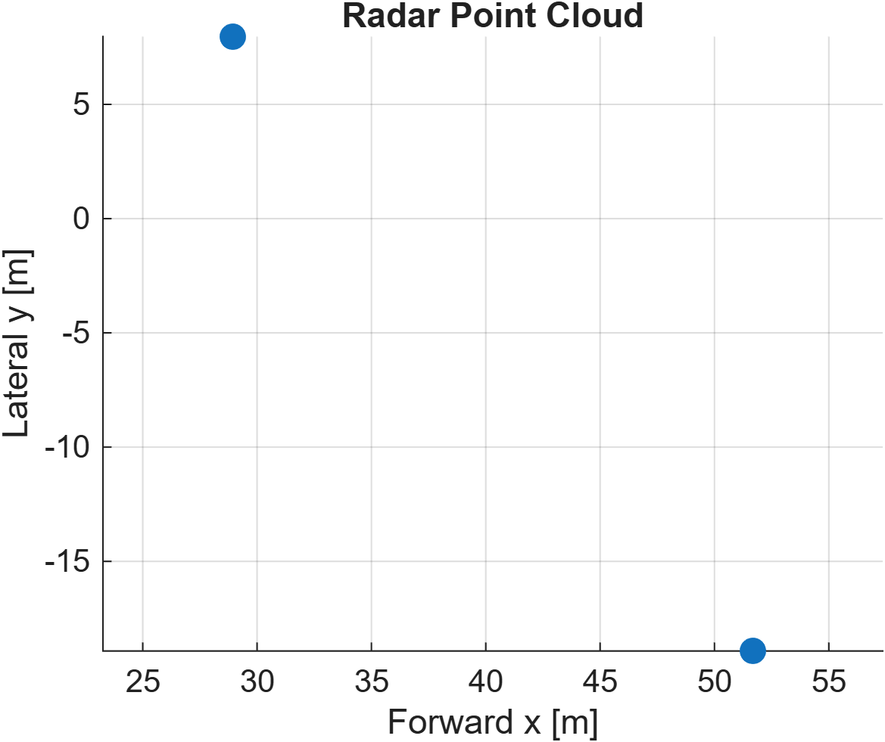
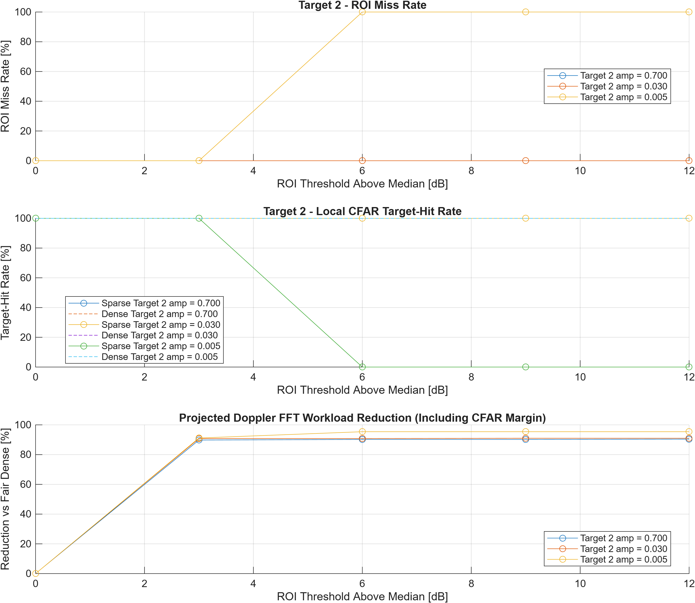

# FMCW Radar DSP — Detection-Centric Sparse Processing

## 1. 프로젝트 개요

MATLAB 기반 FMCW 레이더 신호처리 파이프라인 구현 및 표적 후보 영역만 선택적으로 처리해 연산량을 줄이는 최적화 프로젝트.

목표: 연산량 절감뿐 아니라 검출 손실, 메모리 접근 비용, 제한된 처리 예산까지 함께 검증.

- 레이더: 77 GHz FMCW, 대역폭 1 GHz, 64 Chirps, 1,000 Samples/Chirp
- 안테나: 4 RX (2×2 배열), 방위각·고도각 추정
- 출력: 거리·속도 검출 및 3D Point Cloud

처리 흐름:

`ADC → Range FFT → ROI 선택 → Selective Doppler FFT → CFAR → 각도 추정 → 3D Point Cloud`

## 2. 주요 최적화 결과

| 검증 항목 | 결과 |
|---|---|
| Doppler FFT 횟수 | 2,000 → 176 (91.20% 감소) |
| 전체 FFT 연산량 | 21.10% 감소 (구조적 상한 23.14%) |
| CFAR 검사 셀(CUT) | 25,920 → 216 (99.17% 감소) |
| 데이터 접근량 모델 | 14.475 → 10.210 MiB (29.46% 감소) |
| Dense / Sparse 추정값 | 공통 검출 표적에서 수치 일치 (PASS) |

위 수치는 대표 검증 장면 기준. 전체 FFT 연산량은 ROI 관리 오버헤드 제외, 데이터 접근량은 양쪽에 동일한 Integral-Image CFAR 모델을 적용한 논리적 추정치.

### 검출 성능과 실패 조건

- SNR 20 dB, ROI 3 dB: Dense / Sparse 모두 60/60 검출
- SNR 20 dB, ROI 6 dB: Dense 60/60, Sparse 30/60 — 30건 추가 누락
- 저 SNR 및 밀집 장면: 약한 표적 누락과 고정 FFT 예산의 한계 확인

핵심 결과: 계산량을 줄이는 것과 표적을 놓치지 않는 것은 별개의 문제. ROI 임계값과 처리 예산을 검출 성능과 함께 설계할 필요.

[전체 검증 수치와 실험 한계 보기](#6-상세-검증-결과)

## 3. 검증 결과 시각화

### 3.1 3D Point Cloud — 전체 DSP 구현 결과



### 3.2 ROI 임계값 — 검출 손실과 Doppler 연산량



### 3.3 CFAR 보정 — 약한 표적 검출 특성


## 4. 프로젝트 구성 및 실행

```text
config.m                     # 레이더 설정 / Ground Truth
main.m                       # 기본 DSP / 3D Point Cloud
src/processing/              # Range / Doppler FFT
src/detection/               # CFAR / Peak Grouping
src/angle/                   # 방위각 / 고도각
src/output/                  # Point Cloud / 결과 검증
src/optimization/            # ROI / Top-K / Sparse Processing
phase2_group*.m              # 단계별 최적화 실험
phase2_group5d_main.m        # 공정 CFAR 접근량 모델 검증
phase2_group5e_main.m        # 실제 Sparse FFT / CFAR / AoA 검증
tests/                       # 회귀 테스트
output/phase2/               # 검증 CSV / TXT / PNG
plots/                       # 시각화 결과
```

MATLAB 프로젝트 루트(`config.m` 위치)에서 실행:

```matlab
addpath(genpath("src"));

main
phase2_group5d_main
phase2_group5e_main
```

## 5. Engineering Perspective

Local Optimization ≠ System-Level Optimization

- CFAR 검출에 필요한 ROI 확장 비용
- 전체 FFT 연산량에서 Dense Range FFT가 차지하는 비중
- 저 SNR 및 밀집 장면에서의 표적 누락
- 메모리 접근 모델의 공정성과 처리 예산의 한계

핵심 원칙: 검출 성능과 자원 제약을 고려해 필요한 연산만 선택적으로 수행.

검증 범위: MATLAB 시뮬레이션 및 회귀 검증 완료. 실제 Radar ADC 데이터, 하드웨어 지연시간, 물리적 Peak RAM, 버스 트래픽 및 전력 소비는 미측정.

## 6. 상세 검증 결과

<details>
<summary>세부 수치, RMSE 및 검증 한계 펼쳐보기</summary>

### 전체 정량 결과

| 항목 | 결과 및 조건 |
|---|---|
| Doppler FFT | Fair Dense 2,000 → 176 (91.20% 감소, Group 5A 사례); Group 5C 평균 176.98 |
| Range + Doppler FFT `N log₂N` | 21.10% 감소; Doppler만 제거할 때 구조적 상한 23.14% (Range FFT 비중 76.86%) |
| CFAR CUT | 25,920 → 216 (99.17% 감소, 단일 사례); Group 5E 20 dB / ROI 3 dB 평균 232.2 CUT (약 99.10% 감소) |
| 논리적 버퍼 합계 (모델) | 10.284 → 8.008 MiB (22.13% 감소) |
| 공정 Integral-Image CFAR 접근 모델 | 14.475 → 10.210 MiB (29.46% 감소, Group 5D 단일 장면, PASS) |
| Naive CFAR 접근 모델 (참고) | 54.434 → 10.465 MiB (80.77% 감소); 구현 방식에 민감해 대표값으로 사용하지 않음 |
| Group 5C, SNR 20 dB, ROI 3 dB, 약한 표적 | Sparse 200/200 local hits (amplitude 0.005, CFAR α=4.8) |
| 동일 조건, ROI 4 dB / 5–6 dB | Sparse 59/200 / 0/200 local hits |
| Group 5C, SNR 10 dB, ROI 3 dB | Dense 182/200, Sparse 0/200 local hits |
| 16 Targets 밀집 장면, FFT Cap 200 | 예산 준수 PASS, Dense 검출 48건 중 6건만 보존 (3 Trials 합계) |
| Group 5E 실제 Sparse FFT/CFAR/AoA | SNR 20 dB, ROI 3 dB에서 Dense/Sparse 각 60/60, 공통 표적 추정값 최대 차이 0 |
| CFAR Pfa 보정 | α=4.8, Holdout 78 false alarms / 7,776,000 CUTs |

### Group 5E — 조건부 RMSE

SNR 20 dB, ROI 3 dB, 30 Trials, 공통 검출 60건, 원래 CFAR α≈11.825.

| 경로 | Range (m) | Velocity (m/s) | Azimuth (°) | Elevation (°) | 누락 |
|---|---:|---:|---:|---:|---:|
| Dense | 0.0354 | 0.2053 | 1.2407 | 1.2968 | 0/60 |
| Actual Sparse | 0.0354 | 0.2053 | 1.2407 | 1.2968 | 0/60 |

해석: 공통 검출 표적의 수치적 동등성(회귀) 검증이지 정확도 개선의 증거가 아님. FFT Bin 양자화 오차가 지배적인 결과이며, RMSE는 매칭된 표적에 대해서만 계산한 조건부 값.

SNR 20 dB / ROI 6 dB에서는 Dense 60/60, Sparse 30/60으로 30건 추가 누락. SNR 10 dB / ROI 3 dB에서는 Dense가 이미 약한 표적을 놓쳐 양쪽 모두 30/60이므로, Sparse 추가 누락 0건을 안전성의 근거로 해석할 수 없음.

### 검증 범위와 한계

- Group 5D의 29.46%는 단일 장면의 논리적 데이터 접근 모델 결과. Sparse ROI Energy Read 1.953 MiB는 Range FFT 출력의 추가 읽기로 가정했으며, 계산 융합 시 비용 변화 가능.
- 21.10%는 FFT 연산량 지표. ROI Energy/Median, 정렬, 스케줄링, 버퍼 관리 등 추가 오버헤드 제외.
- Group 5C는 1,600개 독립 Noise Frame에서 Dense CFAR 결과에 ROI Mask를 적용한 통계. Sparse FFT/CFAR를 1,600회 실제 재실행한 것은 아님.
- Group 5C와 5E는 CFAR 계수, Trials, Seed가 달라 직접 동일 조건으로 해석 불가. ±1 Range/Doppler Bin local hit에는 저 SNR의 우연한 Noise Hit 포함 가능.
- FFT Cap 준수는 실제 하드웨어의 WCET 보장이나 표적 보존 보장이 아님.

### 원본 검증 자료

| 검증 | 근거 파일 |
|---|---|
| Group 5D 공정 CFAR 비용 | [비용 비교 CSV](output/phase2/15_fair_cfar_cost_validation/fair_cfar_cost_comparison.csv) · [검증 로그](output/phase2/15_fair_cfar_cost_validation/fair_cfar_cost_validation.txt) |
| Group 5E 검출 및 RMSE | [RMSE/누락 CSV](output/phase2/16_dense_sparse_accuracy_validation/dense_sparse_rmse_and_misses.csv) · [검증 로그](output/phase2/16_dense_sparse_accuracy_validation/dense_sparse_accuracy_validation.txt) |
| Group 5C Monte Carlo | [통계 CSV](output/phase2/14_final_statistical_validation/final_monte_carlo_detection_workload.csv) · [검증 로그](output/phase2/14_final_statistical_validation/final_statistical_validation.txt) |
| Group 5A 자원 모델 | [자원 비교 CSV](output/phase2/12_unified_resource_counters/key_resource_comparison.csv) |

</details>
