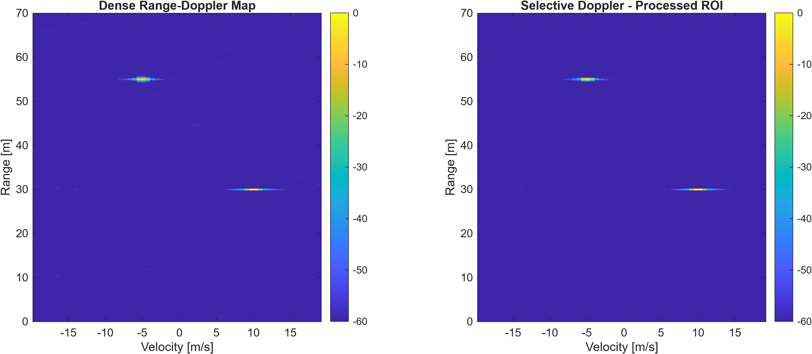
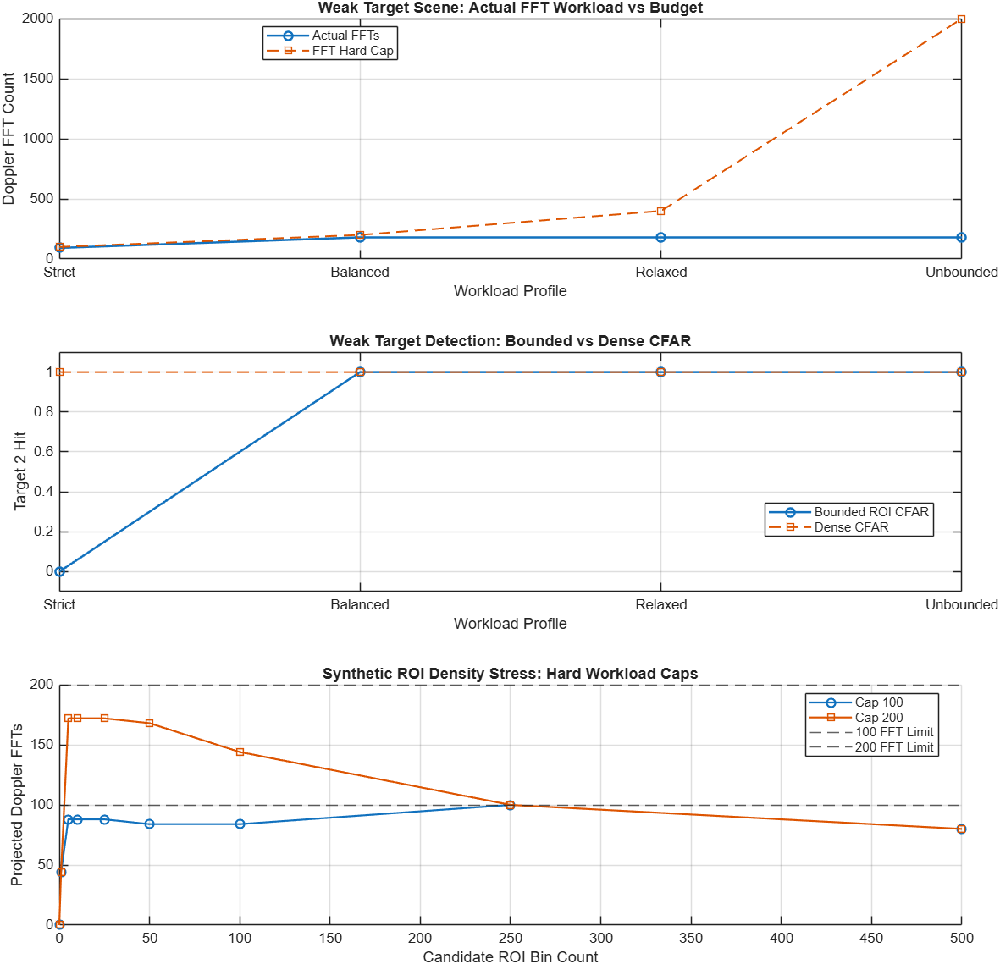
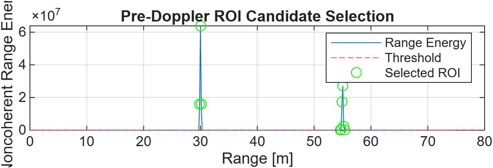
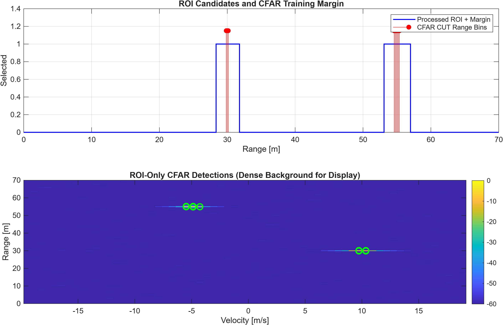
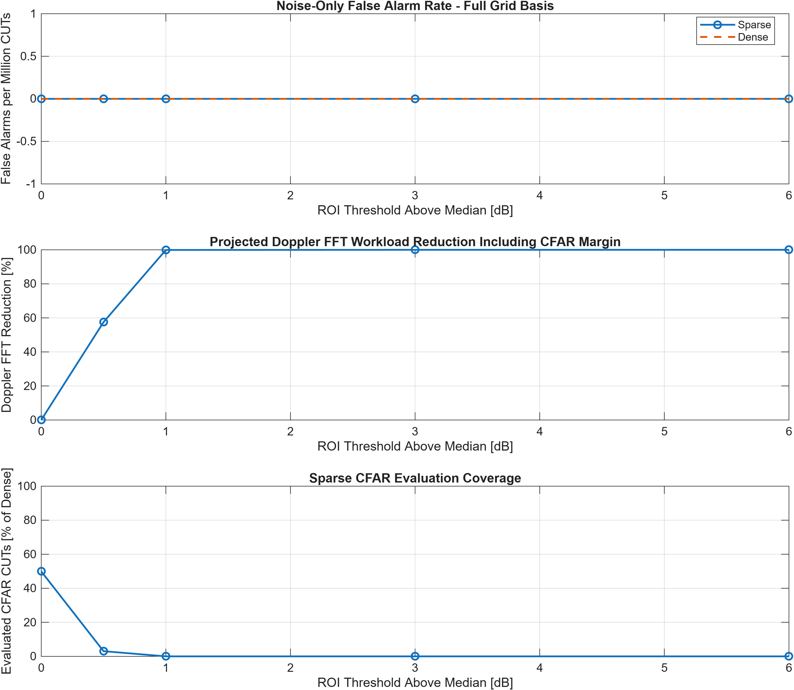
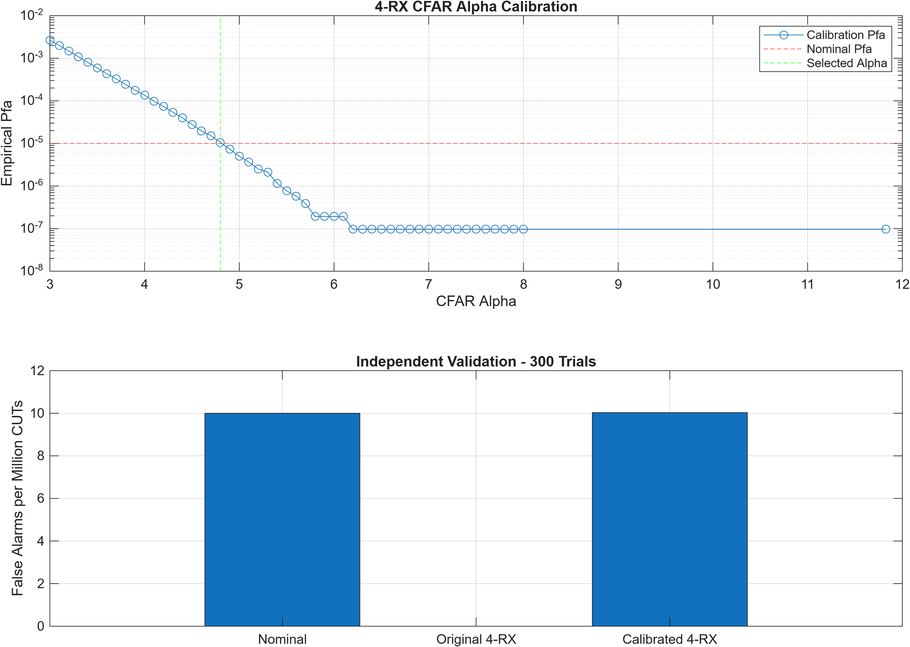
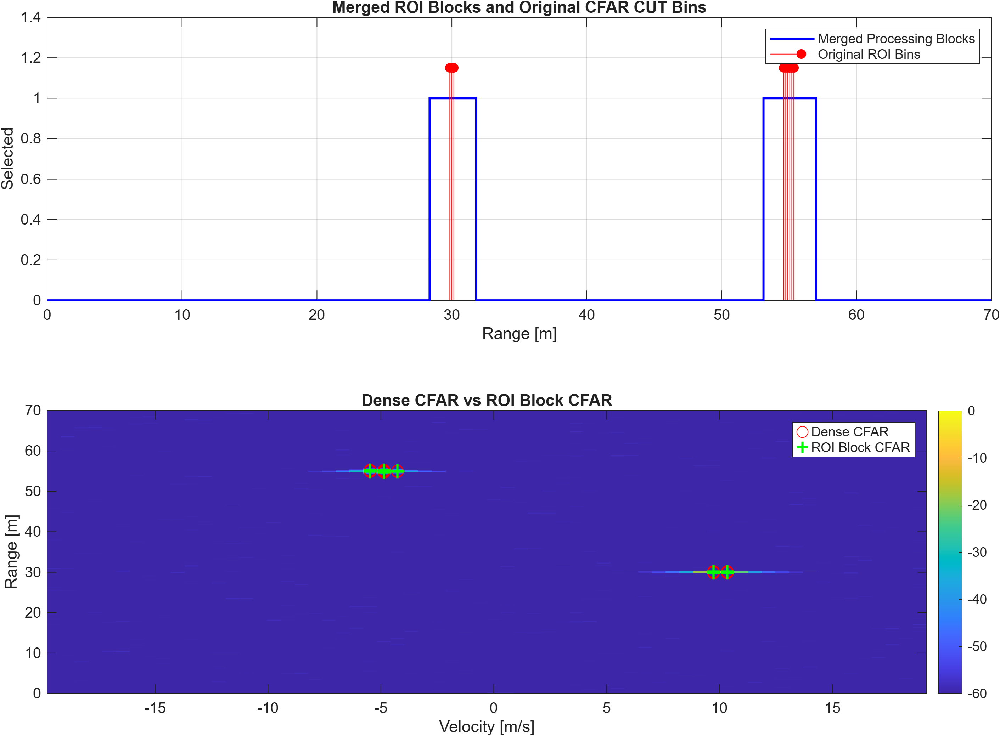
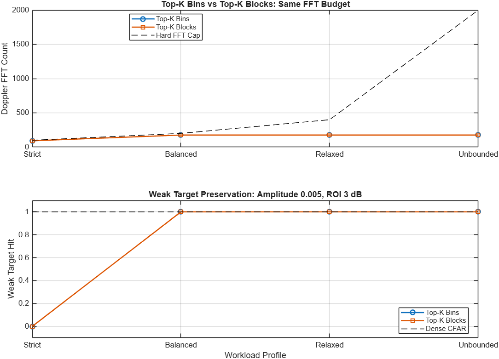

# FMCW Radar DSP with Detection-Centric Sparse Processing

## 1. 프로젝트 개요

FMCW Radar DSP 파이프라인 구현 및 검출 중심의 희소 처리(Sparse Processing) 최적화.

**핵심 목표:** 검출 성능을 고려한 연산량 및 메모리 접근 비용 절감.

## 2. 처리 구조

```text
ADC Cube (Fast Time × RX × Slow Time)
                ↓
         Dense Range FFT
                ↓
        ROI Candidate Selection
                ↓
        Top-K / FFT Budget
                ↓
       CFAR Training / Guard Margin
                ↓
       Selective Doppler FFT
                ↓
           ROI-Only CFAR
                ↓
           Peak Grouping
                ↓
         2D Angle FFT / AoA
                ↓
          3D Point Cloud
                ↓
              CSV
```

### Radar Configuration

| Parameter | Value |
|---|---:|
| Carrier Frequency | 77 GHz |
| Bandwidth | 1 GHz |
| Chirp Duration | 50 μs |
| Sampling Frequency | 20 MHz |
| Samples per Chirp | 1,000 |
| Chirps per Frame | 64 |
| RX Array | 4 RX (2×2 Planar) |
| Range Resolution | 0.15 m |
| Nominal Pfa | 10⁻⁵ |

## 3. 최적화 구조

### ROI Candidate Selection

```text
Range Energy
      ↓
Median Noise Floor
      ↓
Adaptive Threshold
      ↓
Candidate Range Bins
```

Doppler FFT 이전에 후보 Range Bin을 선택하여 불필요한 후속 연산 감소.

### Selective Doppler FFT & ROI CFAR

```text
Candidate Range Bins
        ↓
Training / Guard Margin
        ↓
Selective Doppler FFT
        ↓
ROI-Only CFAR
```

선택된 ROI와 CFAR 계산에 필요한 주변 영역만 처리.

### Bounded Workload

- Top-K Bin / Block Selection
- Doppler FFT 연산량 상한 설정
- 표적 밀도 증가 및 최악 조건에서의 처리 비용 검증

## 4. 주요 검증 결과

### 연산량 비교

Balanced Sparse 설정: 약한 표적 진폭 0.005, ROI Threshold 3 dB.

| 항목 | Dense | Sparse | 절감률 |
|---|---:|---:|---:|
| Doppler FFT Count | 2,000 | 176 | 91.20% |
| CFAR CUT Count | 25,920 | 216 | 99.17% |
| Combined FFT Work | 100% | 78.90% | 21.10% |

- Combined FFT Work: Range FFT와 Doppler FFT의 N log₂N 연산량 모델
- 동일 Integral-Image CFAR 모델 기준 논리적 데이터 접근량 절감: 29.46%

### Dense / Sparse Doppler 비교



### 검출 성능 비교

실제 Sparse FFT 및 ROI CFAR를 적용한 검증 결과.

| 조건 | Dense Hits | Sparse Hits |
|---|---:|---:|
| SNR 20 dB / ROI 3 dB | 60/60 | 60/60 |
| SNR 20 dB / ROI 6 dB | 60/60 | 30/60 |
| SNR 10 dB / ROI 3 dB | 30/60 | 30/60 |

- 공통 검출 표적의 거리·속도·각도 추정값 차이: 0
- 높은 ROI Threshold에서 약한 표적의 검출 손실 발생
- 4-RX CFAR 보정 후 독립 검증 Pfa: 1.003086 × 10⁻⁵

### ROI Threshold Trade-off


### Top-K 연산량 제한



<details>
<summary>추가 검증 그래프</summary>

### ROI Candidate Selection



### ROI CFAR Training Margin



### Noise-Only Pfa



### CFAR Calibration



### Weak Target Detection


### ROI Block Processing



### Top-K Bin / Block 비교



</details>

**모듈화 및 기존 Script 제거 후 전체 Regression: 16/16 PASS**

상세 검증 결과: [`output/phase2/`](output/phase2/)

## 5. Repository Structure

```text
matlab_fmcw_pointcloud/
├── main.m
├── run_radar_pipeline.m
├── phase2_main.m
├── run_phase2.m
├── run_phase2_regression_suite.m
├── src/
│   ├── config/
│   ├── simulation/
│   ├── processing/
│   ├── detection/
│   ├── angle/
│   ├── optimization/
│   └── output/
├── experiments/phase2/
├── tests/
├── output/
└── plots/
```

DSP 처리 모듈, 최적화 실험 및 검증 코드 분리.

## 6. 기술적 고려사항

- 개별 처리 단계의 최적화와 전체 파이프라인의 연산량 절감 구분
- 약한 표적의 검출 손실과 연산량 간 균형
- 표적 밀도 증가에 따른 최대 연산량 제한

**검증 범위:** MATLAB 시뮬레이션 기반 검출 성능, 연산량 및 논리적 메모리 접근 비용 분석.

실제 Radar ADC 데이터, 하드웨어 지연시간, 최대 메모리 사용량, 물리적 데이터 전송량 및 전력 소비는 미측정.

## References

- [TI mmWave SDK](https://www.ti.com/tool/MMWAVE-SDK)
- [TI AWR1843](https://www.ti.com/product/AWR1843)
- [MathWorks Range-Doppler Response](https://www.mathworks.com/help/phased/ug/range-doppler-response.html)
- [MathWorks 2D CFAR Detector](https://www.mathworks.com/help/phased/ref/phased.cfardetector2d-system-object.html)
